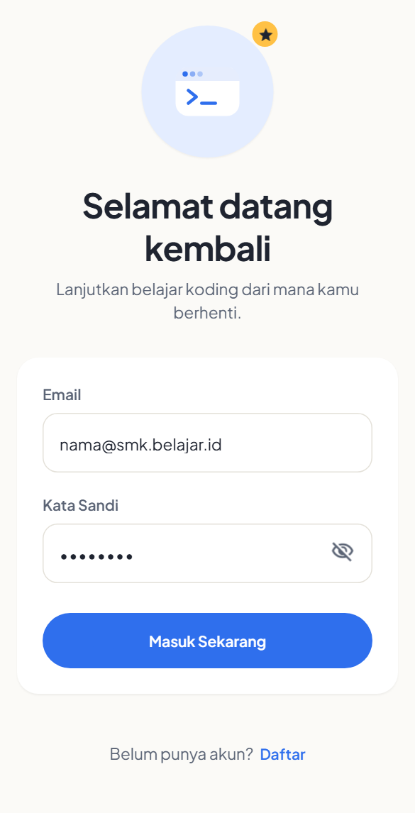
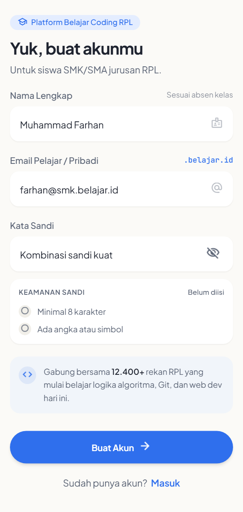
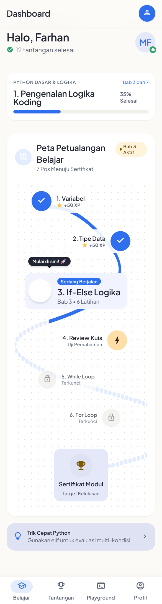
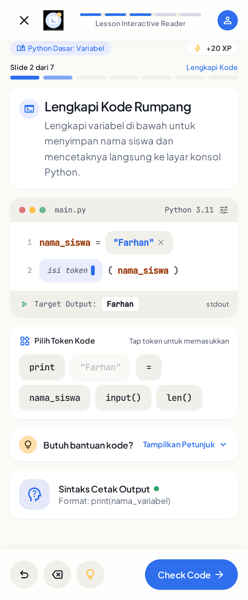
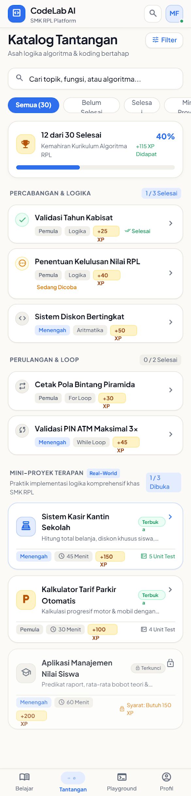
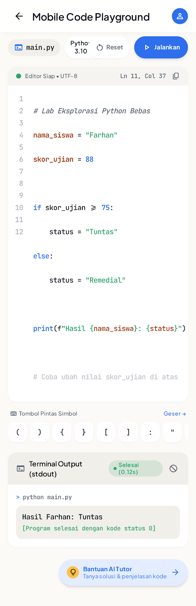
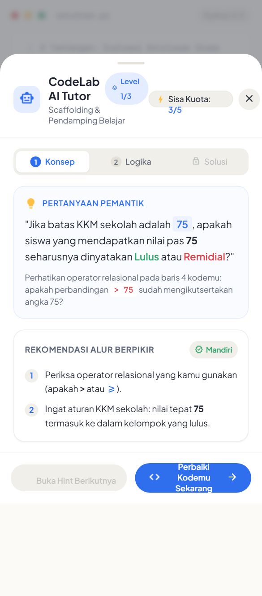
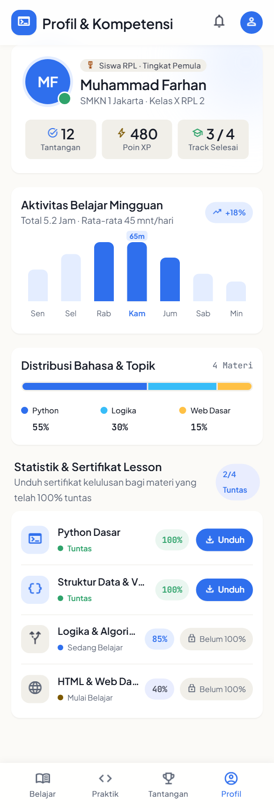

# CodeLab AI — Mobile Learning Platform (Flutter App)


-success)


---

## 📖 Ringkasan Aplikasi

**CodeLab AI** adalah aplikasi mobile pembelajaran pemrograman interaktif berbasis Flutter yang dirancang khusus untuk membantu siswa pemula (*SMK/SMA Rekayasa Perangkat Lunak & Mahasiswa Tahun Pertama*) memahami logika koding dan bahasa pemrograman Python secara bertahap dan terukur.

Aplikasi ini menggabungkan kurikulum mikro interaktif bergaya gamifikasi (*Winding Roadmap* & 7 tipe slide interaktif), tantangan koding berjenjang yang terkunci berdasarkan poin pengalaman (*XP-Gated Challenges*), eksekutor kode Python mandiri di perangkat (**Client-Side Mini Python Runner**), visualisasi **Radar Kompetensi 4 Sumbu**, serta pendamping belajar **AI Tutor berfilosofi Socratic Scaffolding** (memberikan 3 tingkat petunjuk bertahap tanpa membocorkan kode jawaban akhir).

> 📄 **Transparansi Penggunaan AI:** Dokumentasi deklarasi alat AI, pembagian peran modul, serta studi kasus *prompting* dan penyesuaian logika manual dapat dilihat pada berkas **[AI_DECLARATION.md](./AI_DECLARATION.md)**.

---

## 📋 Daftar Isi
1. [Ringkasan Aplikasi](#-ringkasan-aplikasi)
2. [Tangkapan Layar Antarmuka (Screenshot)](#-tangkapan-layar-antarmuka-screenshot)
3. [Fitur Unggulan Aplikasi](#1-fitur-unggulan-aplikasi)
4. [Kebutuhan Sistem & Prasyarat](#2-kebutuhan-sistem--prasyarat)
5. [Langkah Menjalankan Proyek](#3-langkah-menjalankan-proyek)
6. [Akun Demo Pengujian](#4-akun-demo-pengujian)
7. [Arsitektur & Manajemen State](#5-arsitektur--manajemen-state)
8. [Panduan Debugging & Troubleshooting](#6-panduan-debugging--troubleshooting)
9. [Struktur Direktori](#7-struktur-direktori)
10. [Watermark & Hak Cipta](#8-watermark--hak-cipta)

---

## 📱 Tangkapan Layar Antarmuka (Screenshot)

Berikut adalah tampilan antarmuka aplikasi **CodeLab AI** yang dirancang menggunakan sistem desain **Stitch v2** (*Academic Blue & Achievement Gold*):

### 1. Autentikasi Siswa & Peta Belajar (Dashboard)
| Halaman Masuk (`LoginPage`) | Halaman Daftar (`RegisterPage`) | Beranda & Peta Belajar (`DashboardPage`) | Pembaca Materi 7 Tipe Slide (`LessonReaderPage`) |
| :---: | :---: | :---: | :---: |
|  |  |  |  |
| *Form masuk dengan validasi & prefill email otomatis* | *Registrasi profil akademik siswa (NISN, Sekolah, Kelas)* | *Kartu Resume & Winding Roadmap 7 pos menuju sertifikat* | *Slide belajar interaktif (Tap to Fill, Bug Hunter, Kuis, dll.)* |

### 2. Tantangan Koding, Playground, AI Tutor & Profil Kompetensi
| Katalog Tantangan (`ChallengeCatalogPage`) | Code Playground (`PlaygroundPage`) | Bantuan AI Tutor (`AiTutorSheet`) | Profil & Radar Kompetensi (`ProfilePage`) |
| :---: | :---: | :---: | :---: |
|  |  |  |  |
| *Soal tantangan & mini-proyek dengan prasyarat poin XP* | *Editor koding mobile dengan Quick-Symbol Bar & Terminal* | *Modal Bottom Sheet 3 tingkat petunjuk tanpa bocoran solusi* | *Statistik XP, Radar Kompetensi 4 Sumbu, & Sertifikat* |

---

## 1. Fitur Unggulan Aplikasi

1. **Mesin Pembaca Materi 7 Tipe Slide (`LessonReaderPage`):**
   * Mendukung 7 variasi interaksi belajar dalam satu bab: *Theory Concept*, *Tap to Fill*, *Type Code*, *Output Predictor*, *Bug Hunter*, *Multiple-Choice Quiz*, dan *Lesson Summary*.
   * Dilengkapi penyimpanan progres per-slide ke server dan klaim hadiah poin XP.

2. **Client-Side Mini Python Runner (`MiniPythonRunner`):**
   * Mesin interpretasi subset bahasa Python yang berjalan langsung di perangkat lokal (*on-device*), mendukung `print`, variabel, `if/elif/else`, `for/while` dengan *infinite-loop guard*, fungsi (`def`), `list`, `dict`, *f-string*, hingga `try-except`.

3. **Mobile Code Editor & Quick-Symbol Toolbar:**
   * Editor kode monospaced (*JetBrains Mono*) dengan nomor baris, *syntax highlighting*, dan bilah pintasan karakter koding (`:`, `()`, `""`, `Tab`, `=`, `[]`, `+`, `-`).

4. **AI Tutor Socratic Scaffolding (`AiTutorSheet`):**
   * Disajikan sebagai *Modal Bottom Sheet* di atas editor kode (bukan *room chat* bebas) dengan 3 level petunjuk (*Konsep*, *Alur Logika*, *Sintaks*) serta *AI Error Explainer* berbahasa Indonesia dan kuota 5x/hari dari server.

5. **Visualisasi Radar Kompetensi 4 Sumbu & Progres Kurikulum:**
   * Memetakan penguasaan siswa pada 4 dimensi (**Logika**, **Variabel**, **Perulangan**, **Fungsi**) menggunakan `fl_chart`, serta menampilkan daftar progres seluruh *track* kurikulum dan sertifikat kelulusan.

---

## 2. Kebutuhan Sistem & Prasyarat

Sebelum mengompilasi dan menjalankan proyek ini, pastikan lingkungan kerja Anda memenuhi persyaratan berikut:

* **Sistem Operasi:** Windows 10/11 (Command Prompt / CMD), macOS, atau Linux.
* **Flutter SDK:** Versi `3.24.0` atau lebih baru (Dart SDK `^3.12.2`).
  ```cmd
  flutter doctor
  ```
* **Target Eksekusi:**
  * **Web Desktop (Cepat & Responsif):** Brave Browser atau Google Chrome.
  * **Android:** Android Emulator (API Level 21+) atau perangkat Android fisik.
* **Backend API Gateway (Opsional namun Direkomendasikan):**
  * Layanan backend Go berjalan di `http://localhost:8080` (untuk Web/Desktop) atau `http://10.0.2.2:8080` (diakses otomatis dari Android Emulator). Jika server sedang mati, aplikasi memiliki mekanisme *graceful offline fallback* ketika `ApiClient.isNetworkError` terdeteksi.

---

## 3. Langkah Menjalankan Proyek

### Langkah 1: Masuk ke Direktori Frontend Mobile
Buka **CMD (Command Prompt)** dan arahkan ke folder `mobile-codelab-ai`:
```cmd
cd /d "D:\@UNDERGROUND DEV\@edukasi-coding\mobile-codelab-ai"
```

### Langkah 2: Pasang Dependensi Paket Flutter
Unduh seluruh pustaka yang terdaftar pada `pubspec.yaml`:
```cmd
flutter pub get
```

### Langkah 3: Jalankan Aplikasi

#### Opsi A — Menggunakan Skrip Peluncur Cepat (`dev-mobile.bat`)
Cukup jalankan skrip berikut dari dalam folder `mobile-codelab-ai`:
```cmd
dev-mobile.bat
```

#### Opsi B — Menjalankan di Browser Desktop (Chrome / Brave)
```cmd
flutter run -d chrome
```
*(Jika menggunakan Brave Browser dan Chrome tidak terpasang, set path terlebih dahulu):*
```cmd
set "CHROME_EXECUTABLE=C:\Program Files\BraveSoftware\Brave-Browser\Application\brave.exe"
flutter run -d chrome
```

#### Opsi C — Menjalankan di Android Emulator / Perangkat Fisik
1. Periksa ID perangkat atau emulator yang aktif:
   ```cmd
   flutter devices
   ```
2. Jalankan aplikasi:
   ```cmd
   flutter run -d <device-id>
   ```

### Langkah 4: Menjalankan Analisis Kode & Unit Test
Untuk memastikan tidak ada *error* statis dan seluruh pengujian berjalan lulus:
```cmd
flutter analyze
flutter test
```

---

## 4. Akun Demo Pengujian

Anda dapat langsung mencoba seluruh fitur aplikasi menggunakan akun siswa demo berikut pada halaman Login:

* **Email:** `farhan@smk.belajar.id`
* **Kata Sandi:** `rahasia123`

Atau mendaftarkan akun siswa baru melalui halaman **Daftar Akun (`RegisterPage`)**.

---

## 5. Arsitektur & Manajemen State

Aplikasi dibangun mengikuti pola **Feature-First Clean Architecture**:

* **State Management:** `flutter_bloc` (`AuthCubit`, `DashboardCubit`) dipadukan dengan strategi *stale-while-revalidate* berbasis sinyal `appShellTabActivated` (`ValueNotifier<int>`).
* **Routing & Route Guard:** `go_router` dengan `_AuthNotifier` (otomatis mengarahkan ke `/login` bila belum masuk) dan `StatefulShellRoute.indexedStack` untuk menjaga memori 4 tab utama.
* **Networking:** `dio` (`ApiClient`) dengan *baseUrl* adaptif, pembubuhan *Bearer token* otomatis, dan *single-flight refresh token* (`_refreshInFlight`) saat menerima HTTP 401.
* **Penyimpanan Sesi Terenkripsi:** `flutter_secure_storage` (`TokenStore`) yang mengamankan token di dalam Android Keystore / iOS Keychain / Windows DPAPI.

---

## 6. Panduan Debugging & Troubleshooting

1. **Gagal Terhubung ke Backend pada Android Emulator (`Connection Refused`):**
   * `ApiClient` secara otomatis mengalihkan `localhost` ke `http://10.0.2.2:8080/api/v1` saat berjalan di Android Emulator. Pastikan server backend Go aktif pada port `8080` di komputer host.
2. **Membersihkan Cache Build apabila Terjadi Kendala Aset/Font:**
   ```cmd
   flutter clean
   flutter pub get
   ```

---

## 7. Struktur Direktori

```text
mobile-codelab-ai/
├── assets/
│   ├── fonts/                      # Font lokal (Plus Jakarta Sans & JetBrains Mono)
│   └── screenshots/                # Tangkapan layar antarmuka aplikasi (Stitch v2)
├── lib/
│   ├── app/
│   │   ├── router/                 # Konfigurasi GoRouter (app_router.dart, app_routes.dart)
│   │   └── shell/                  # AppShell 4 tab & sinyal global appShellTabActivated
│   ├── core/
│   │   ├── network/                # ApiClient (Dio, Bearer, refresh 401), TokenStore
│   │   ├── theme/                  # Design tokens: palette, spacing, typography, theme
│   │   ├── utils/                  # Validators form (nama, regex email, kata sandi)
│   │   └── widgets/                # Komponen UI bersama (AppLoadingScreen, CodeWindowShell, dll.)
│   ├── features/
│   │   ├── ai_tutor/               # Modal Bottom Sheet AI Tutor 3 level hint & kuota 5x/hari
│   │   ├── auth/                   # Login, Register, AuthCubit, ApiAuthRepository & Mock
│   │   ├── challenges/             # Katalog tantangan koding, detail soal, & EvaluationSheet
│   │   ├── dashboard/              # Beranda siswa, ResumeCard, & WindingRoadmap
│   │   ├── lesson/                 # Pembaca materi 7 tipe slide & lesson_parser.dart
│   │   ├── playground/             # Editor kode bebas & MiniPythonRunner on-device
│   │   └── profile/                # Profil siswa, radar kompetensi 4 sumbu, & SettingsPage
│   └── main.dart                   # Titik masuk aplikasi, pemulihan sesi, & registrasi provider
├── test/                           # Suite pengujian otomatis (21 unit & widget tests)
├── AI_DECLARATION.md               # Deklarasi transparansi penggunaan AI & studi kasus prompting
├── dev-mobile.bat                  # Skrip peluncur cepat aplikasi mobile
├── pubspec.yaml                    # Konfigurasi dependensi paket & aset Flutter
└── README.md                       # Dokumentasi utama repositori frontend
```

---

## 8. Watermark & Hak Cipta

* **Aplikasi:** CodeLab AI — Mobile Learning Platform
* **Pengembang / Author:** Devwan Hidayawan — `2413025009` (<wanzzhd8@gmail.com>)
* **Program Studi:** Pendidikan Teknologi Informasi, FKIP, Universitas Lampung
* **Repositori GitHub:** [https://github.com/2413025009/app-codelab.git](https://github.com/2413025009/app-codelab.git)

```text
================================================================================
  Copyright (c) 2026 CodeLab AI Development Team. All Rights Reserved.
  Developed by: Devwan Hidayawan (2413025009) <wanzzhd8@gmail.com>
================================================================================
```
